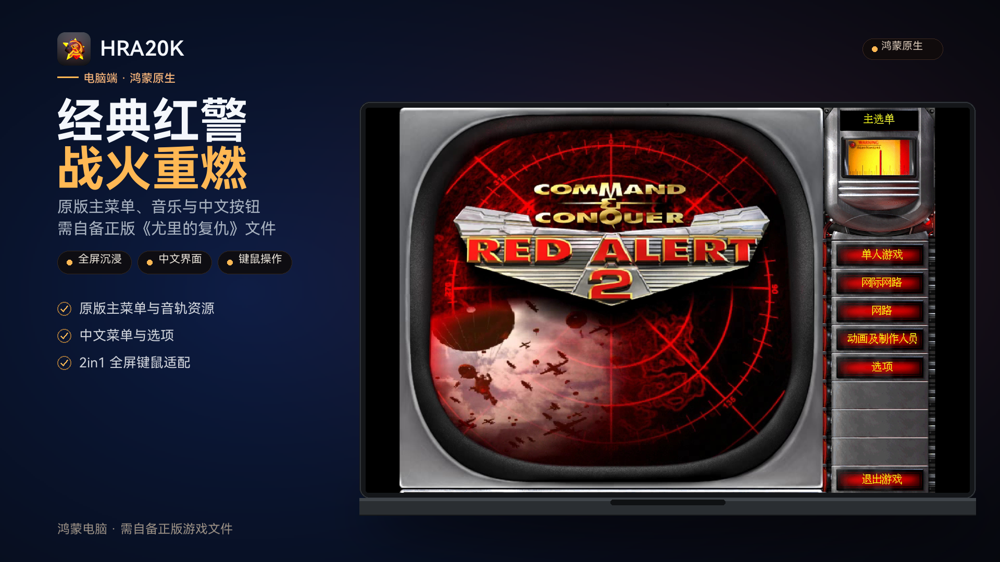
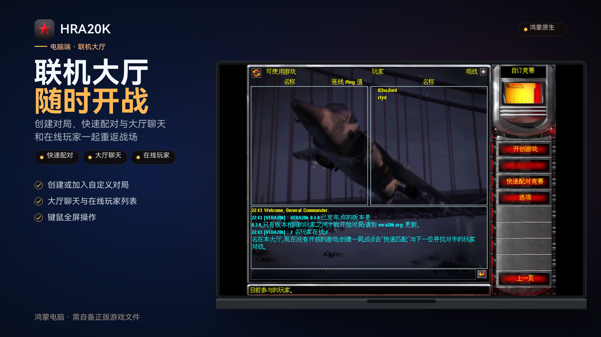
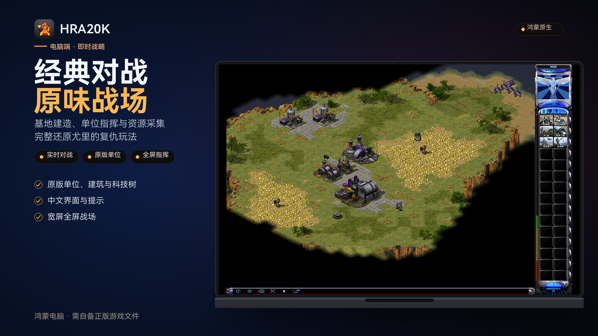

# HRA20K

[VERA20K](https://github.com/YuriPlanet/vera20k) 的 HarmonyOS 2in1 移植，用于运行《命令与征服：红色警戒2 尤里的复仇》。


## 功能

- 原版主菜单、音乐与中文界面
- 战役、遭遇战与联机大厅
- 2in1 全屏键鼠操作
- 导入界面：选择包含 `ra2md.mix` 与 `ra2.mix` 的游戏文件夹，复制到应用私有目录；电影包体积过大，不参与导入

> 本程序不包含任何游戏文件，需要自备正版《红色警戒2：尤里的复仇》。

| 主菜单 | 联机大厅 | 游戏对战 |
| --- | --- | --- |
|  |  |  |

## 环境

- HarmonyOS 7.0 及以上，API 26，仅 2in1（电脑）
- DevEco Studio 6.0 及以上
- Rust 工具链，目标 `aarch64-unknown-linux-ohos`

## 构建

1. 编译引擎（在 `vera20k-main/` 中）：

   ```sh
   cargo build -p vera20k-ohos --target aarch64-unknown-linux-ohos --release
   <SDK>/default/openharmony/native/llvm/bin/llvm-strip --strip-debug \
     -o ../entry/libs/arm64-v8a/libvera20k_ohos.so \
     target/aarch64-unknown-linux-ohos/release/libvera20k_ohos.so
   ```

2. 签名配置：复制 `build-profile.sample.json5` 为 `build-profile.json5`，在 DevEco Studio 中配置本地签名。`build-profile.json5`、`local.properties` 与 `entry/libs/` 已被 `.gitignore` 排除，避免提交签名口令、证书路径与本机产物。

3. 使用 DevEco Studio 打开工程构建，或执行：

   ```sh
   hvigorw assembleHap --mode module -p product=default -p module=entry@default -p buildMode=debug
   ```

## 目录

- `AppScope/` — 应用级配置与分层图标
- `entry/` — HarmonyOS 应用（ArkTS 界面、游戏文件导入、打包后的引擎库）
- `vera20k-main/` — VERA20K 引擎源码（含 OHOS 入口与 GPLv3 许可文件）
- `tools/promo/` — 宣传图渲染脚本与素材
- `store/` — 图标与宣传图
- `build-profile.sample.json5` — 签名配置样例

## 开源许可

HRA20K 以 GNU GPL v3 发布，全文见 [LICENSE](LICENSE)。本仓库即其对应源代码。引擎来自 VERA20K，附加条款见 [vera20k-main/LEGAL.md](vera20k-main/LEGAL.md)；应用启动画面与「许可」页显示同样的版权、分享许可、无担保声明以及上游与本移植版的源码地址。第三方组件与完整声明见 [THIRD_PARTY_NOTICES.md](THIRD_PARTY_NOTICES.md)。

| 项目 | 角色 | 许可证 | 地址 |
| --- | --- | --- | --- |
| HRA20K | 本项目（HarmonyOS 移植） | GPLv3 | https://github.com/IChuJianI/HRA20K |
| VERA20K | 游戏引擎 | GPLv3 及附加条款 | https://github.com/YuriPlanet/vera20k |
| Ares | 可选 Ares 支持的代码来源 | Ares Contributors 许可 | https://github.com/Ares-Developers/Ares |
| Phobos | 可选 Phobos 支持的代码来源 | GPLv3 | https://github.com/Phobos-developers/Phobos |
| FFmpeg | Bink 视频解码器与 xBR 缩放器 | GPLv3 | https://ffmpeg.org |
| Noto / GNU Unifont | 界面字体 | SIL OFL 1.1 | https://github.com/notofonts · https://unifoundry.com/unifont/ |
| Rust（含 LLVM libunwind） | 引擎运行时（静态链入 .so，不含独立二进制） | MIT / Apache-2.0 WITH LLVM-exception | https://www.rust-lang.org · https://llvm.org/LICENSE.txt |

VERA20K™ 是 Halvor Nikolai Rusten 的商标。HRA20K 是社区修改版，不是 VERA20K 官方版本，与其权利人无隶属关系。《命令与征服》与《红色警戒》是 Electronic Arts Inc. 的商标；《红色警戒2：尤里的复仇》及其游戏文件版权归 Electronic Arts 所有。程序图标与截图使用《红色警戒2》的红星等游戏美术，归 Electronic Arts 所有；HRA20K 与 Electronic Arts 无隶属关系，也未获其认可或授权。

## 作者

李晨 · 3093376617@qq.com
